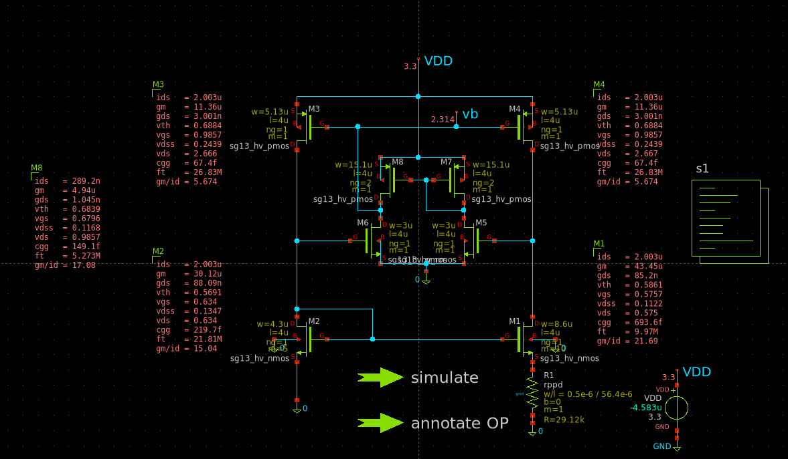
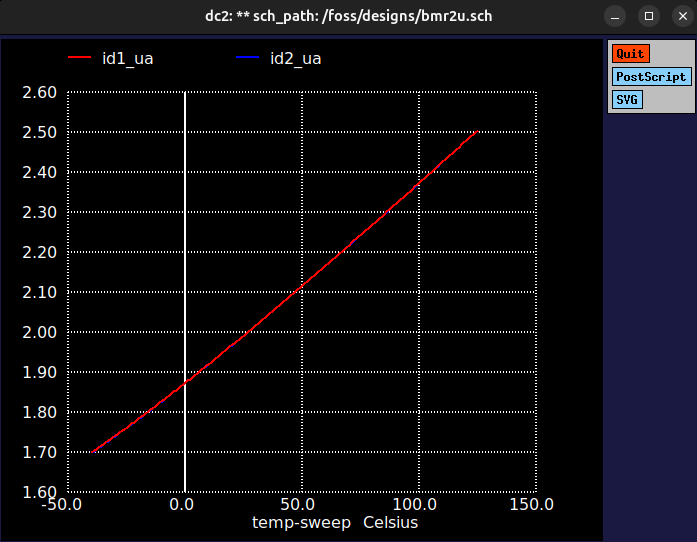
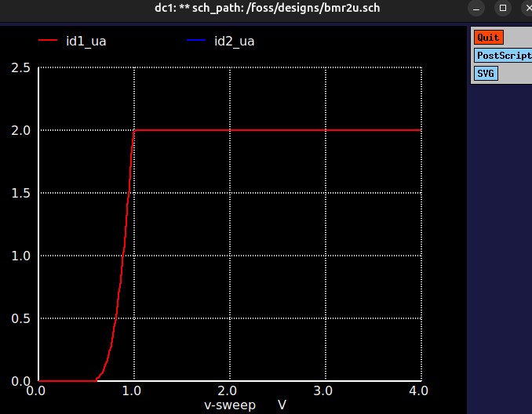

# BMR2U: 2 uA low-power beta multiplier reference

A **2 uA beta multiplier reference (BMR)** with an amplifier-regulated PMOS mirror, designed in **IHP SG13G2** with HV devices (`sg13_hv_nmos`, `sg13_hv_pmos`), VDD = 3.3 V. It is a bias-current source meant for low-power analog blocks.

Design goals: **low power, small area, good temperature behaviour.**

The devices were sized with **[AutoBMR](https://github.com/satouhfares/AutoBMR)**, a gm/Id sizing tool I wrote for this circuit, and then checked with the ngspice sweeps shown below.



---

## What is a BMR

A beta multiplier reference is a self-biased current source. Two NMOS transistors share one gate voltage. One is `K` times wider and has a resistor `R` in its source, so the difference of their gate-source voltages falls across `R`:

```
I * R = dVgs        in weak inversion:   I = n * Ut * ln(K) / R
```

`Ut = kT/q` grows with temperature, so the current is **PTAT-like**: it rises with temperature when `R` stays constant. The resistor type sets the final temperature coefficient.

An amplifier (input pair and load) forces the two branch voltages to be equal, so the PMOS mirror copies the current accurately and the current barely depends on VDD.

More details: see the [AutoBMR README](https://github.com/satouhfares/AutoBMR#readme).

---

## Results

Typical corner (TT), VDD = 3.3 V.

| Quantity | Value |
|---|---|
| Current at 27 C | 2.003 uA |
| Minimum current (-40 C) | 1.700 uA |
| Maximum current (125 C) | 2.506 uA |
| Temperature coefficient (box method) | 2440 ppm/C |
| Current at VDD = 3.0 V / 3.6 V | 2.00268 uA / 2.00267 uA |
| Line regulation | -0.0012 %/V |

The temperature coefficient is `TC = (Imax - Imin) / (Imean * 165 C)`.

| Current vs temperature | Current vs VDD |
|---|---|
|  |  |

- The line regulation is excellent: the current changes by a few parts per million over the VDD range.
- The current rises with temperature, as expected from a PTAT-like reference with a low-TC resistor. A flatter curve needs a resistor with a positive TC in series, at the cost of area.

---

## Files

```
BMR2U/
├── README.md
├── design/
│   ├── BMR2U.sch        xschem schematic
│   └── BMR2U.spice      ngspice netlist (temperature and VDD sweeps)
└── docs/images/
    ├── BMR2U.png
    ├── tempsweep.png
    └── VDDsweep.png
```

## Run the simulation

Inside the IIC-OSIC-TOOLS container (it provides ngspice and the SG13G2 models):

```bash
cd design
ngspice BMR2U.spice
```

---

## Notes

- **A startup circuit is required.** A BMR has a second stable state where no current flows, and it can stay there at power-up. The startup circuit must turn itself off once the reference runs. Check power-up with slow and fast VDD ramps over temperature and corners.
- **A stability capacitor may be needed** on the PMOS gate node. Check the loop with a loop-break AC simulation.
- Results above are for the typical corner only. Corners and mismatch are not covered here.
